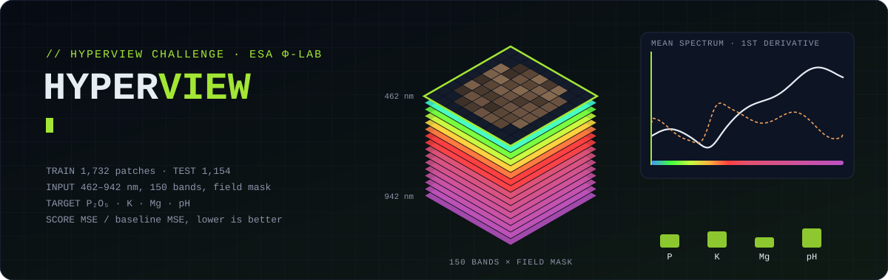
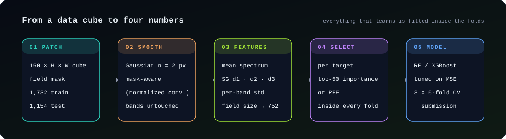

<picture>
  <source media="(prefers-color-scheme: dark)" srcset="./docs/assets/header-dark.svg">
  <source media="(prefers-color-scheme: light)" srcset="./docs/assets/header-light.svg">
  
</picture>

Estimating **phosphorus (P₂O₅), potassium (K), magnesium (Mg) and pH** of agricultural soil from airborne hyperspectral patches. The data comes from the [HYPERVIEW / "Seeing Beyond the Visible" challenge](https://platform-challenges.philab.esa.int/seeing-beyond-the-visible-permanent/) (ESA Φ-lab, KP Labs, QZ Solutions).

<p align="center">
  
  
  
  
</p>

## The task

- **2,886 patches:** 1,732 for training and 1,154 for testing. Each patch has **150 bands (462–942 nm)** over one field, with a mask marking the pixels outside the field.
- **Score:** the mean over the four targets of `MSE(model) / MSE(baseline)`, where the baseline always predicts the training mean. **1.0 is the baseline and lower is better.**

## Method

<picture>
  <source media="(prefers-color-scheme: dark)" srcset="./docs/assets/pipeline-dark.svg">
  <source media="(prefers-color-scheme: light)" srcset="./docs/assets/pipeline-light.svg">
  
</picture>

```
patch (150 × H × W, masked)
  └─ masked spatial Gaussian smoothing (σ = 2 px, bands never mixed)
       └─ field pixels ─┬─ mean spectrum ── Savitzky–Golay 1st derivative ── 2nd, 3rd derivative
                        ├─ per-band spatial std (field heterogeneity)
                        └─ field size (pixel count, log)
            = 752 features
  └─ per target: feature selection (top-50 by Extra-Trees importance, or RFE) → Random Forest / XGBoost
```

**Why these features:**
- Soil chemistry leaves weak, broad absorption features, so derivatives of the spectrum emphasize their shape over the overall brightness.
- PCA in the [EDA notebook](notebooks/eda.ipynb) shows that 2 components explain ~99% of pixel variance, so raw bands are highly redundant.
- Field size and heterogeneity are cheap extra signals. Roughly 38% of the patches are small fields.

### Methodology fixes in v2

The first version reported ~0.91 on a local hold-out. Six problems made that estimate unreliable or held the model back:

| # | Problem | Fix |
|---|---|---|
| 1 | **Selection leakage:** RFE was fitted on all data *before* the train/test split, so the test rows influenced which features were chosen | The selector is the first step of a scikit-learn `Pipeline`, so it is refitted on the training part of every split |
| 2 | **Metric mismatch:** hyperparameters were tuned for MAE, but the score is MSE-based | The search optimizes `neg_mean_squared_error` |
| 3 | **One feature set for four targets:** P, K, Mg and pH are weakly correlated (Spearman ρ between 0.01 and 0.38) but shared one RFE ranking | Each target has its own pipeline and its own selected features |
| 4 | **Background leaking into the field:** the Gaussian blur ran on the raw array, mixing out-of-field pixels into the field edges | Normalized convolution: blur(data · mask) / blur(mask) |
| 5 | **A single 80/20 split:** differences of ±0.01 between variants were within noise | **Repeated K-fold** (3 × 5 by default), reported as mean ± standard error |
| 6 | **Only spectral-derivative features** | Added the mean spectrum, per-band spatial std and field size. Every group can be switched off with `--features` for ablations |

## Results

| Protocol | Model | Score |
|---|---|---|
| v1: single 80/20 split, selection before split (leaky) | RF, 450 derivative features, RFE → 50 | 0.910–0.923 |
| v2: 3 × 5-fold CV, everything fitted inside folds | RF, 752 features, per-target top-50 | *run `python -m hyperview cv`* |

> The v1 number is optimistic because of points 1 and 5. The v2 CV estimate is the one to compare variants with. The official test score comes from uploading `outputs/submission_<model>.csv` to the challenge platform.

## Reproduce

### 1. Data

Download the dataset from the [challenge page](https://platform-challenges.philab.esa.int/seeing-beyond-the-visible-permanent/data) (registration may be required) and unpack it into `data/`:

```
data/
├── train_data/
│   ├── train_data/        0.npz … 1731.npz
│   ├── train_gt.csv       sample_index, P, K, Mg, pH
│   └── wavelengths.csv
└── test_data/             0.npz … 1153.npz
```

Use `--data-dir PATH` if the data lives somewhere else.

### 2. Environment

```bash
python -m venv .venv && source .venv/bin/activate     # Windows: .venv\Scripts\activate
pip install -r requirements.txt
```

### 3. Run

```bash
python -m hyperview all                 # features → tune → CV score → submission
```

Or step by step:

```bash
python -m hyperview features            # extract and cache features (outputs/features/)
python -m hyperview tune                # per-target randomized search, saves outputs/best_params_*.json
python -m hyperview cv                  # repeated K-fold HYPERVIEW score, saves outputs/cv_*.csv
python -m hyperview submit              # fit on all training data → outputs/submission_rf.csv
```

Useful variants:

```bash
python -m hyperview all --model xgb                 # XGBoost instead of Random Forest
python -m hyperview cv  --selector rfe              # RFE selection (much slower)
python -m hyperview cv  --features d1 d2 d3         # ablation: derivatives only (close to v1)
python -m hyperview cv  --n-features 100 --cv-repeats 5
```

Everything is seeded (`--seed`, default 123), and all outputs go to `outputs/`. `tune` is the slow step because every candidate refits the feature selector in every fold. Use `--tune-iter` to trade search depth for time.

### Tests

The tests build a small synthetic dataset in the same file layout and run the full pipeline end to end. No real data is needed:

```bash
pip install -r requirements-dev.txt
python -m pytest
```

## Repository

```
hyperview/
├── config.py        all settings (paths, preprocessing, selection, models, CV)
├── data.py          loading patches and labels, writing submissions
├── features.py      masked smoothing and feature extraction, with caching
├── selection.py     Extra-Trees importance and RFE selectors
├── models.py        per-target pipelines, hyperparameter search, mean baseline
├── evaluation.py    HYPERVIEW score and repeated K-fold CV
├── plots.py         quick-look plots for a single patch
└── __main__.py      command-line interface
notebooks/eda.ipynb  exploratory analysis: masks, spectra, band correlation, PCA, target correlations
tests/               synthetic-data tests
```

## Team

University team project at the Silesian University of Technology: [@igorkotlarz1](https://github.com/igorkotlarz1), [@KamiLMusiol](https://github.com/KamiLMusiol), [@KarolPethe](https://github.com/KarolPethe), [@hascilopiotr](https://github.com/hascilopiotr).
